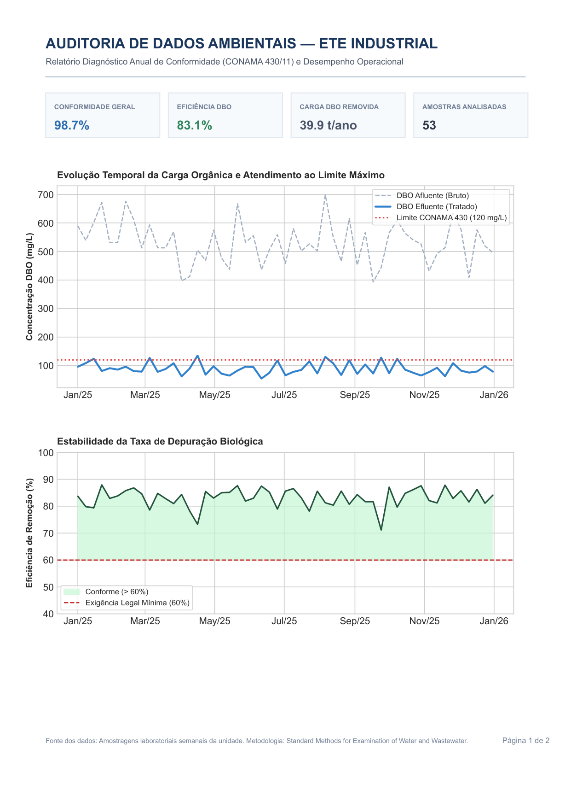
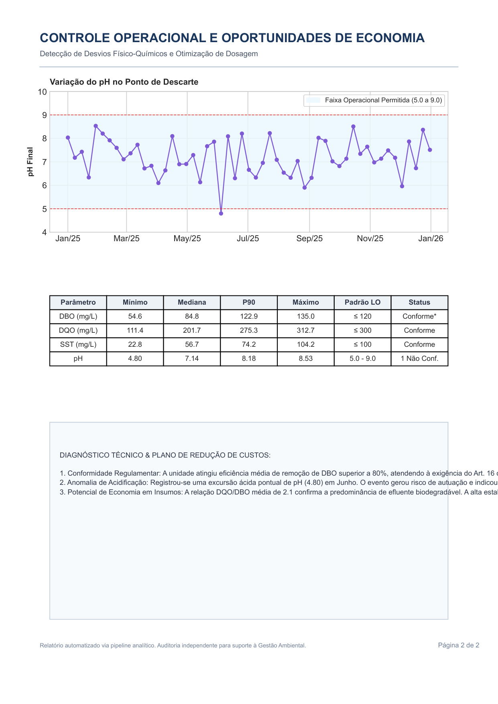

# Auditoria e Diagnóstico de Conformidade para ETE Industrial

Pipeline analítico em Python para auditoria automatizada de estações de tratamento de efluentes industriais (ETE), confrontando séries temporais de monitoramento físico-químico frente aos limites legais da **Resolução CONAMA nº 430/2011** e licenças ambientais de operação.

# Demonstração do Relatório Executivo

# Objetivo de Negócio

Muitas operações industriais mantêm planilhas de laudos laboratoriais apenas como formalidade regulatória. Este projeto automatiza a identificação de:
1. **Riscos de Autuação:** Taxas reais de conformidade e detecção de excursões críticas (DBO, DQO, pH, SST).
2. **Eficiência de Remoção Biológica:** Acompanhamento contínuo da depuração de carga orgânica (meta legal de abatimento ≥ 60%).
3. **Otimização de Insumos:** Correlações operacionais (DQO/DBO) para subsidiar redução de custos com neutralizadores e coagulantes químicos.

# Entregável Executivo

O pipeline processa a série histórica de monitoramento e gera um **Relatório Diagnóstico Executivo de 2 Páginas** em alta resolução (PDF vetorial A4) pronto para apresentação à diretoria e fiscalização ambiental:

## 📊 Entregável Executivo

O pipeline processa a série histórica de monitoramento e gera um **Relatório Diagnóstico Executivo de 2 Páginas** em alta resolução (PDF vetorial A4) pronto para apresentação à diretoria e fiscalização ambiental:

  

  

- **Página 1:** Painel de KPIs de conformidade geral, tabela descritiva (mínimo, mediana, P90, máximo) e gráfico temporal afluente vs. efluente com eficiência de abatimento.
- **Página 2:** Monitoramento fino de pH com limites operacionais, balanço de cargas e parecer técnico direcionado à redução de custos e mitigação de passivos.

- **Página 1:** Painel de KPIs de conformidade geral, tabela descritiva (mínimo, mediana, P90, máximo) e gráfico temporal afluente vs. efluente com eficiência de abatimento.
- **Página 2:** Monitoramento fino de pH com limites operacionais, balanço de cargas e parecer técnico direcionado à redução de custos e mitigação de passivos.

# Stack Tecnológica

- **Linguagem:** Python 3.10+
- **Processamento e Métricas:** `pandas`, `numpy`
- **Visualização e Renderização PDF:** `matplotlib` (Backend vetorial `PdfPages`)

# Licença e Propriedade Intelectual

Este código é distribuído sob licença proprietária exclusiva para fins de exibição de portfólio. É proibida a cópia, redistribuição ou uso comercial sem autorização prévia por escrito. Consulte o arquivo [LICENSE](LICENSE) para maiores detalhes.

# Contato para Diagnósticos e Consultoria

Interessado em aplicar este modelo de inteligência de dados na estação de tratamento da sua indústria ou consultoria ambiental?

- **Gabriel Siqueira dos Santos**
- **Especialidade:** Tecnologia em Saneamento Ambiental & Análise de Dados
- **Serviços:** Auditoria de conformidade, relatórios automatizados para órgãos ambientais e diagnóstico de dosagem química.